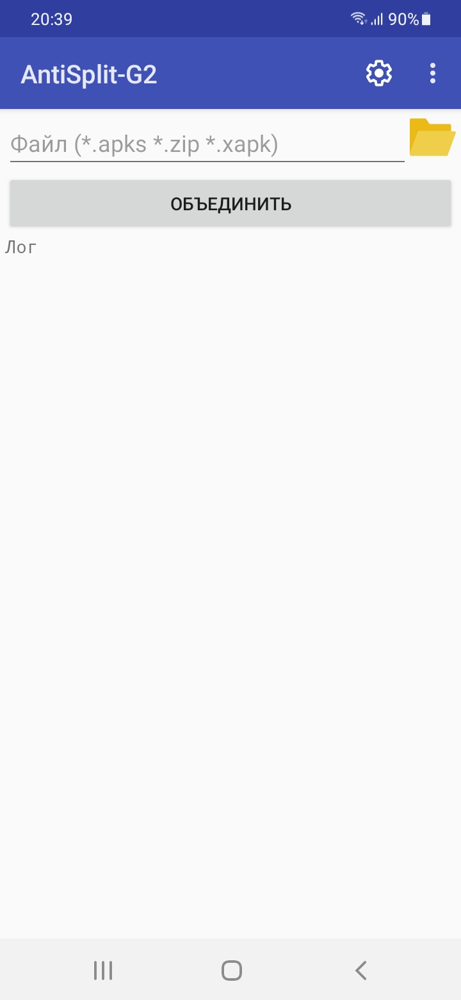
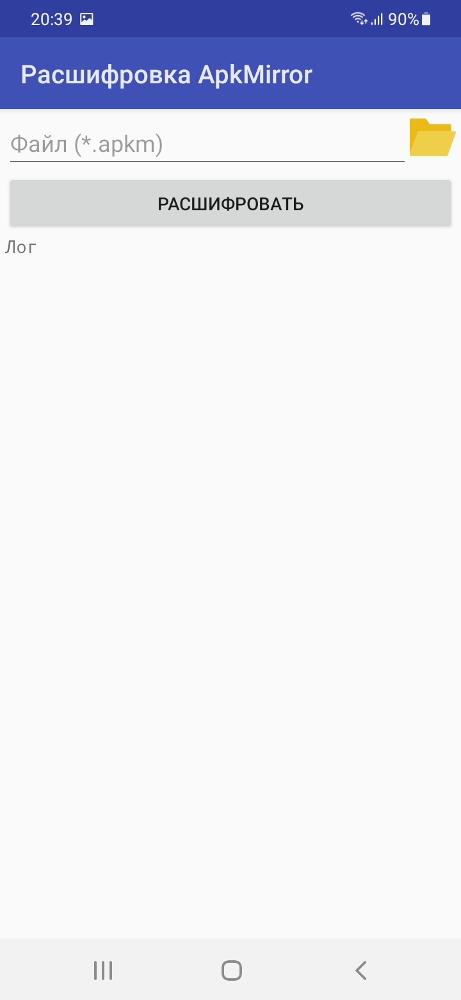

# AntiSplit-G2

## Download
<!--  -->

## 📂 Project Files

## Photo

## ⚙️ How to Use in CodeAssist
1. Download or clone this repository.
2. Open CodeAssist on your device.
3. Locate the downloaded esp-tester-v1.caproj file.
4. Import or open the project in a compatible editor.
5. If the file format is not supported, check whether the project needs to be exported to a supported format.
6. Edit the project files as needed.
7. Save your changes.

## 🚀 Requirements
* Android device
* CodeAssist
* Compatible project format